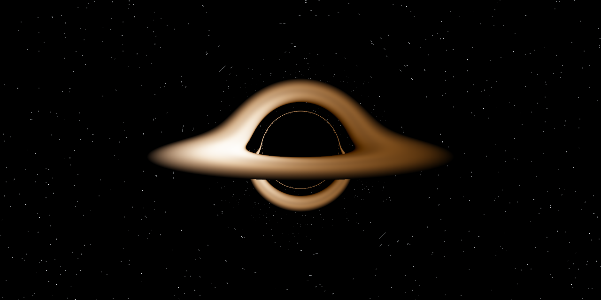
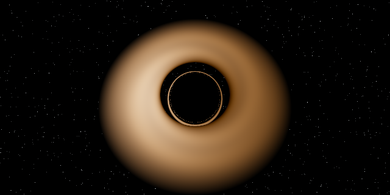
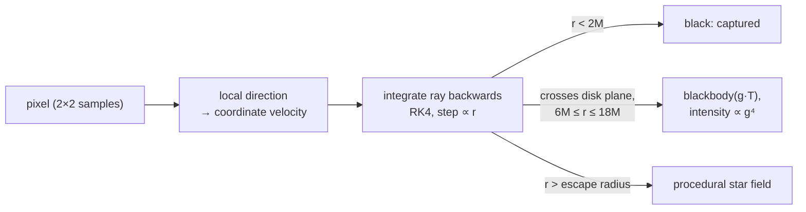

# schwarzschild-raytracer

A physically based black-hole renderer in Rust. Light rays are traced backwards from a camera
through curved Schwarzschild spacetime to a thin accretion disk, with gravitational lensing,
gravitational redshift and relativistic Doppler beaming.





## What you're seeing

- **Shadow.** Rays aimed inside the critical impact parameter $b_c = 3\sqrt3\,M$ fall through the horizon.
- **Lensed far side.** The disk behind the hole is bent up over the top of the shadow, and its
  underside appears as a thinner arc below.
- **Photon ring.** A thin bright line hugging the shadow, made by light that orbits near r = 3M before escaping.
- **Doppler beaming.** The disk rotates towards the camera on the left: that side is blueshifted
  and much brighter, while the receding side is redder and dimmer.

## Physics

Units are G = c = M = 1, so the horizon is at r = 2.

**Rays.** A light ray stays in a plane, and its orbit u(φ) = 1/r obeys $u'' + u = 3Mu^2$. If
(r, φ) are read as flat polar coordinates, that is exactly the path of a particle under

$$\ddot{\mathbf x} = -\frac{3Mh^2}{r^5}\,\mathbf x,\qquad h = |\mathbf x\times\dot{\mathbf x}|\ \text{(conserved)}.$$

So each ray is integrated in plain 3D Cartesian coordinates with RK4, using a step proportional to
r. There are no coordinate singularities, and no per-ray orbital plane to set up.

**Camera.** A static observer at radius r sees a direction with radial part $n_r$ and tangential
part $n_\perp$ in its own local frame. Because proper radial distance is $dr/\sqrt{1-2M/r}$, that
direction maps to the coordinate velocity $n_r\sqrt{1-2M/r}\,\hat r + n_\perp$. This gives exactly
the right impact parameter, $b = r n_\perp/\sqrt{1-2M/r}$, which the tests check.

**Disk.** The disk is thin and Keplerian, from the ISCO (6M) to 18M, with flux
$F \propto (1-\sqrt{r_{\rm in}/r})/r^3$ and local temperature $T\propto F^{1/4}$.

**Redshift.** For an emitter on a circular orbit, $\Omega = \sqrt{M/r^3}$, seen by the static camera:

$$g = \frac{\nu_{\rm obs}}{\nu_{\rm em}} = \frac{\sqrt{1-3M/r}}{\sqrt{1-2M/r_{\rm cam}}\,\left(1 - \Omega\, b_{\rm axis}\right)}$$

Here $b_{\rm axis}$ is the photon's angular momentum about the disk axis per unit energy. Observed
colour temperature is $gT$ and bolometric intensity is $g^4 I$.



## Validation

| test | what it checks against |
|---|---|
| `rays_inside_the_critical_impact_parameter_are_captured` | rays with b = 0.97 b_c are captured and b = 1.03 b_c escape ($b_c = 3\sqrt3 M$) |
| `weak_field_deflection_is_4m_over_b` | light bending of $4M/b + 15\pi M^2/4b^2$ at b = 500M, to within 0.5 % |
| `photon_sphere_is_a_circular_orbit` | r = 3M stays circular, with b = b_c |
| `shadow_edge_matches_synges_formula` | shadow edge at $\sin\alpha = (3\sqrt3 M/r)\sqrt{1-2M/r}$, checked at ±0.5 % |
| `impact_parameter_of_a_camera_ray_matches_the_local_angle` | the camera mapping gives $b = r\sin\alpha/\sqrt{1-2M/r}$ |
| `face_on_redshift_at_the_isco_is_sqrt_one_half` | g = √(1 − 3M/6M) = 0.7071 |
| `approaching_side_is_blueshifted_relative_to_receding_side` | sign of the Doppler term |
| `flux_vanishes_at_the_inner_edge_and_peaks_just_outside` | flux peak at r = (49/36) r_in |

## Run it

```bash
cargo test --release
cargo run --release -- 1280 640 82 docs/blackhole.png   # width height inclination output
```

The 1280×640 frame, at 4 samples per pixel (3.3 M rays), takes about 19 s on 2 cores; rows run in
parallel with `rayon`.

## Honest limits

- Non-rotating (Schwarzschild) black hole. A spinning (Kerr) hole would shift and flatten one side of the shadow.
- The emission model is a simple blackbody per radius, with no radiative transfer or limb darkening.
- **Cosmetic, not physics:** faint spiral banding and a soft fade at the outer rim, so the disk
  reads as gas. Both are marked in `src/lib.rs`.

## References

- J.-P. Luminet, *Image of a spherical black hole with thin accretion disk*, Astron. Astrophys. 75, 228–235 (1979).
- J. L. Synge, *The escape of photons from gravitationally intense stars*, Mon. Not. R. Astron. Soc. 131, 463–466 (1966).
- O. James, E. von Tunzelmann, P. Franklin, K. S. Thorne, *Gravitational lensing by spinning black holes in astrophysics, and in the movie Interstellar*, Class. Quantum Grav. 32, 065001 (2015).

## License

MIT
